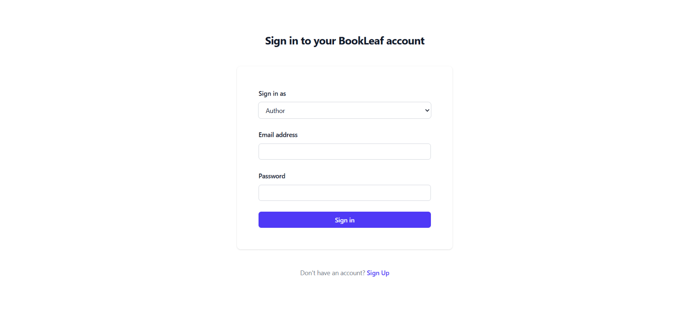
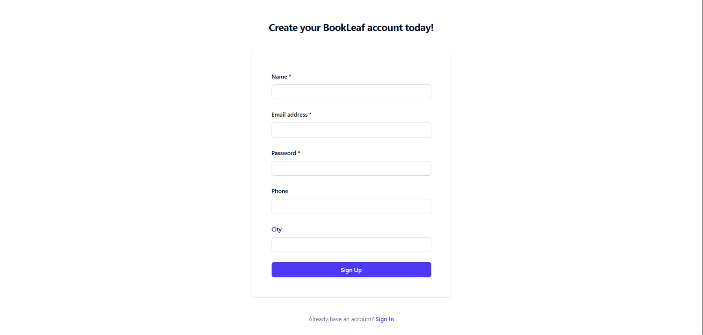
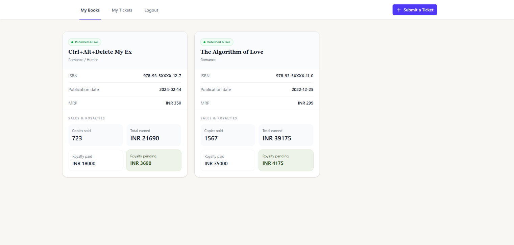
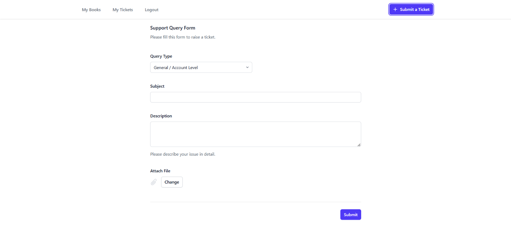
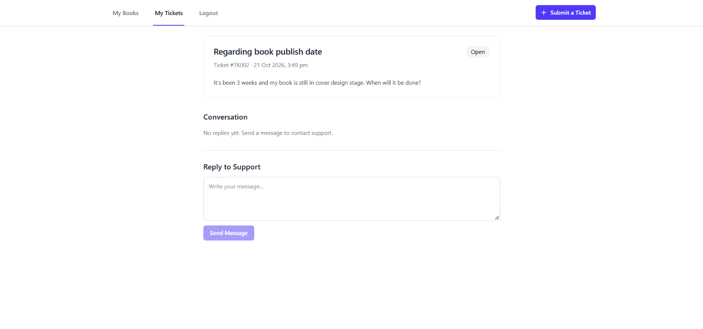
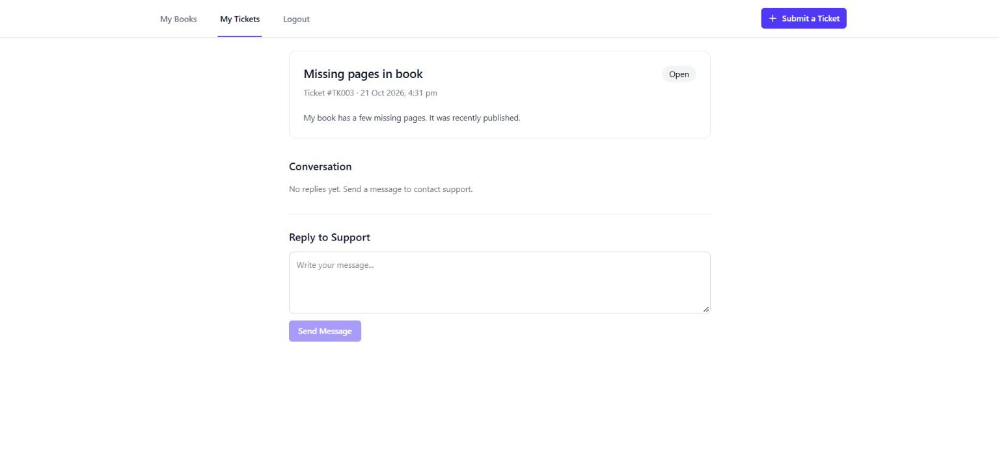
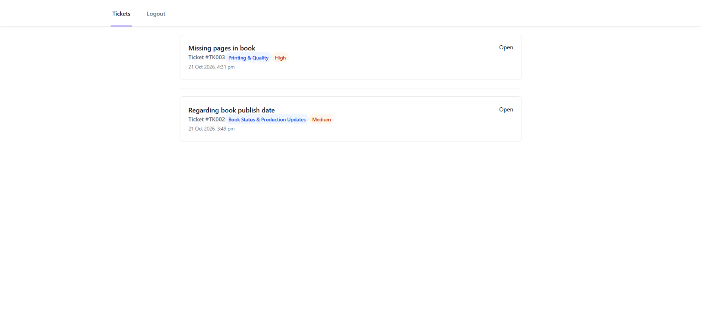
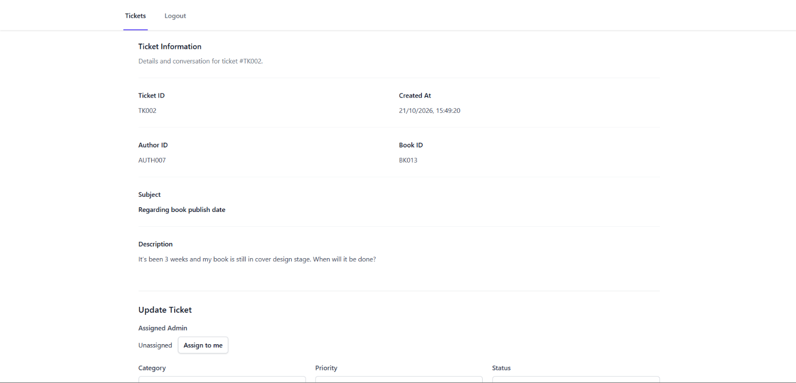
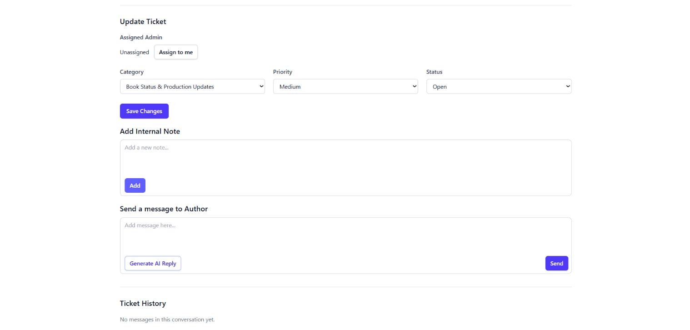
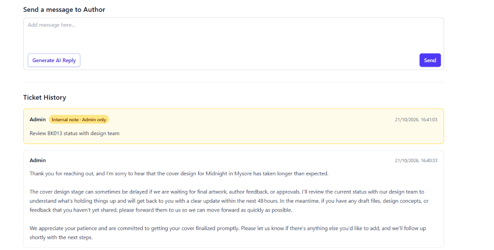

# Author Support & Communication Portal

A full-stack author support portal for enabling authors to manage their books and support tickets while admins handle ticket assignments, classification, communication, and AI-assisted response drafting.

## Demo

- **Live Application:** https://author-support-and-communication-portal-1.onrender.com
- **API Documentation:** https://author-support-and-communication-portal.onrender.com/docs

## **Test Credentials**

- For admin:
    - Email: admin@email.com
    - Password: password

- For authors:
    - Database seeded with the sample data in `backend\app\bookleaf_sample_data.json`
    - Password: password

## Docker Setup

### Prerequisites

- [Docker Desktop](https://www.docker.com/products/docker-desktop/) installed and running.
- Git to clone the repository.
- A Groq API key for AI-powered features.

### 1. Clone the Repository

```bash
git clone https://github.com/mayuripaliwal/author-support-and-communication-portal.git
cd author-support-and-communication-portal
```

### 2. Configure Environment Variables

Create a `backend/.env` file using the required variable names from the backend .env.example file

Configure the following values:

- `JWT_SECRET_KEY`: A strong, randomly generated secret used for JWT signing.
- `GROQ_AUTHOR_SUPPORT_PORTAL_API`: Your Groq API key.
- `GROQ_MODEL`: The model used for AI-powered features, for example `openai/gpt-oss-120b`.

### 3. Build and Start the Application

From the repository root, run:

```bash
docker compose up --build -d
```

**Note:** The first Docker build may take several minutes while Docker downloads the required images and installs dependencies.

### 4. Initialize the Database

After the backend is running and the migrations have completed, seed the database with the provided sample data:

```bash
docker compose exec backend python -m app.seed_script
```

Run the seed command once on a fresh database.

### 5. Access the Application

- **Frontend:** http://localhost:5173
- **Backend API documentation:** http://localhost:8000/docs

Use the demo credentials documented in this README to test author and administrator functionality.

### 6. Stop the Application

Stop and remove the containers and network:

```bash
docker compose down
```

The named PostgreSQL volume is preserved, so database data remains available when the application is started again.

To stop the application and delete the associated database volume as well, run:

```bash
docker compose down -v
```

### 1. Authentication






### 2. Author Portal








### 3. Admin Portal








## Assumptions and Design Decisions

The following assumptions and design decisions were made while implementing the Author Support & Communication Portal.

### 1. Data Modeling and Identifiers

- **MRP representation:** The MRP (Maximum Retail Price) of a book is stored as an integer, assuming prices are represented in whole currency units without fractional values.

    As a consequence, author royalty per copy, total royalty earned, royalty paid, and royalty pending are stored as integers, assuming all monetary amounts are represented in whole currency units without fractional values.
- **String-based primary keys:** The primary key formats for authors, books, admins, tickets, and ticket messages follow the conventions used in the provided sample dataset. IDs use prefixes such as `AUTH`, `BK`, `AD`, `TK`, and `TM`, respectively. String-based primary keys were chosen to preserve consistency with the supplied data and the application's ID-generation conventions.

### 2. Ticket Creation and Categorization

- **Book-specific or general queries:** An author can raise a support ticket associated with a specific book or submit a general/account-level query without selecting a book. Accordingly, the ticket's `book_id` is optional.
- **Automatic ticket categorization:** Authors are not required to select a ticket category during creation. Instead, the category is inferred from the ticket's subject and description using AI, with administrators able to review and update it when necessary.
- **Optional category and priority:** Ticket category and priority can be `NULL` when AI classification fails. These fields can subsequently be populated or updated by an administrator.

### 3. Author and Administrator Accounts

- **Administrator provisioning:** Administrator accounts cannot be created through the portal. They are provisioned manually rather than through public registration.
- **Published books:** The author's *My Books* view displays books whose status is `Published & Live`. Books in earlier production stages are excluded from this view. This behavior can be extended if the requirements change.

### 4. Ticket Assignment and Administration

- **Claim-before-work workflow:** An administrator must assign a ticket to themselves before modifying its details or handling its support conversation. Unassigned tickets cannot be modified or handled by administrators until claimed.
- **Assignment ownership:** Once a ticket has been assigned, only the assigned administrator can work on it. Other administrators cannot modify the ticket or send messages on its behalf.
- **No self-service unassignment:** The portal does not provide an option to unassign a ticket once it has been claimed. Assignment changes or reassignment would require an additional workflow if needed in the future.

### 5. Internal Notes and Message Visibility
- Shared message storage: Internal notes and conversation messages are stored in the same ticket_messages table. Each record's visibility field distinguishes public messages from private internal notes.
- Multiple internal notes: An administrator can create multiple internal notes for a ticket. Each note is stored as a separate ticket message with visibility = Private.
- Author-facing message filtering: Author-facing ticket details and conversation endpoints return only messages with visibility = Public. Private internal notes are excluded from author responses and are visible only to authorized administrators.
- Administrative visibility: Administrators can view both public conversation messages and private internal notes when viewing ticket history. However, viewing a ticket does not grant permission to modify it; modification and message-sending permissions remain restricted to the assigned administrator.

### 6. AI Integration

- **Automatic classification:** AI-based category and priority classification is triggered when a ticket is created. The intention is to make classification results available for administrator triage without requiring manual categorization. Because classification can fail, category and priority may temporarily be `NULL`.
- **On-demand AI reply generation:** AI-generated replies are created only when an administrator explicitly requests a draft. Drafts are displayed for review and editing before the administrator sends them to the author. Generated drafts are not persisted in the database as separate records; only messages actually sent are stored in the ticket conversation.

## Tech Stack

| Layer | Technologies |
|---|---|
| Frontend | React, Vite, Tailwind CSS, React Router |
| Backend | Python, FastAPI |
| Database | PostgreSQL |
| ORM and Migrations | SQLAlchemy, Alembic |
| Authentication | JWT, HttpOnly cookies, Argon2 password hashing |
| AI Integration | Groq API |
| Background Processing | FastAPI BackgroundTasks |
| Deployment | Render (frontend, backend, PostgreSQL) |

## API Endpoints

All protected endpoints require authentication through the `access_token` HttpOnly cookie. Author and administrator endpoints enforce role-based access.

### Authentication

| Method | Endpoint | Description |
|---|---|---|
| GET | `/health` | Check API health |
| POST | `/signup` | Register a new author account |
| POST | `/login` | Authenticate an author or administrator |
| POST | `/logout` | Clear the authentication cookie |
| GET | `/auth` | Verify the current authenticated session and retrieve the user's role |

### Author Endpoints

| Method | Endpoint | Description |
|---|---|---|
| GET | `/author/books` | Retrieve the authenticated author's books; supports the `published_only` query parameter |
| POST | `/tickets` | Create a support ticket and schedule background classification |
| GET | `/tickets` | Retrieve the authenticated author's tickets and public responses |
| GET | `/tickets/{ticket_id}` | Retrieve details of a specific ticket belonging to the author |
| POST | `/tickets/{ticket_id}/message` | Add a author sent message to the author's ticket |

### Administrator Endpoints

| Method | Endpoint | Description |
|---|---|---|
| GET | `/admin/tickets` | Retrieve tickets across the portal, including their responses |
| GET | `/admin/tickets/{ticket_id}` | Retrieve detailed information for a specific ticket |
| POST | `/admin/tickets/{ticket_id}` | Assign a ticket to the authenticated administrator |
| PATCH | `/admin/tickets/{ticket_id}` | Update ticket category, priority, or status |
| POST | `/admin/tickets/{ticket_id}/internal_note` | Add a private internal note to a ticket |
| POST | `/admin/tickets/{ticket_id}/message` | Send a public response to the author |
| POST | `/admin/tickets/{ticket_id}/generate-reply` | Generate an AI-assisted response draft using ticket context and the knowledge base |

## Database Schema

The application uses PostgreSQL with five tables: `authors`, `admins`, `books`, `tickets`, and `ticket_messages`. SQLAlchemy models define primary keys, foreign keys, uniqueness, nullability, server defaults, enums, and a check constraint.

### 1. `authors`

Stores author account and profile information.

| Column | Type | Constraints |
|---|---|---|
| `author_id` | `VARCHAR(20)` | Primary key, NOT NULL |
| `name` | `VARCHAR(255)` | NOT NULL |
| `email` | `VARCHAR(255)` | UNIQUE, NOT NULL |
| `phone` | `VARCHAR(30)` | NULL allowed |
| `city` | `VARCHAR(100)` | NULL allowed |
| `joined_date` | `DATE` | NOT NULL, defaults to the current date |
| `password_hash` | `VARCHAR(255)` | NOT NULL |

### 2. `admins`

Stores administrator account credentials.

| Column | Type | Constraints |
|---|---|---|
| `admin_id` | `VARCHAR(20)` | Primary key, NOT NULL |
| `email` | `VARCHAR(255)` | UNIQUE, NOT NULL |
| `password_hash` | `VARCHAR(255)` | NOT NULL |

### 3. `books`

Stores book metadata, production status, sales, and royalty information.

| Column | Type | Constraints |
|---|---|---|
| `book_id` | `VARCHAR(20)` | Primary key, NOT NULL |
| `author_id` | `VARCHAR(20)` | Foreign key → `authors.author_id`, NOT NULL |
| `title` | `VARCHAR(500)` | NOT NULL |
| `isbn` | `VARCHAR(20)` | UNIQUE, NOT NULL |
| `genre` | `VARCHAR(150)` | NOT NULL |
| `publication_date` | `DATE` | NULL allowed |
| `status` | `ENUM` (`BookStatus`) | NOT NULL; restricted to defined book statuses |
| `mrp` | `INTEGER` | NULL allowed |
| `author_royalty_per_copy` | `INTEGER` | NULL allowed |
| `total_copies_sold` | `INTEGER` | NOT NULL |
| `total_royalty_earned` | `INTEGER` | NOT NULL |
| `royalty_paid` | `INTEGER` | NOT NULL |
| `royalty_pending` | `INTEGER` | NOT NULL |
| `last_royalty_payout_date` | `DATE` | NULL allowed |
| `print_partner` | `VARCHAR(100)` | NULL allowed |
| `available_on` | `JSON` | NOT NULL; defaults to an empty list in the ORM |

**Book status values:** Manuscript Received, Editing, Cover Design, Typesetting, Proofreading, ISBN Assignment, Printing, Distribution Setup, Published & Live.

### 4. `tickets`

Stores author support requests and their assignment and workflow details.

| Column | Type | Constraints |
|---|---|---|
| `ticket_id` | `VARCHAR(20)` | Primary key, NOT NULL |
| `author_id` | `VARCHAR(20)` | Foreign key → `authors.author_id`, NOT NULL |
| `book_id` | `VARCHAR(20)` | Foreign key → `books.book_id`, NULL allowed |
| `status` | `ENUM` (`TicketStatus`) | NOT NULL; restricted to defined ticket statuses |
| `subject` | `VARCHAR(200)` | NOT NULL |
| `description` | `TEXT` | NOT NULL |
| `category` | `ENUM` (`TicketCategory`) | NULL allowed; restricted to defined categories |
| `priority` | `ENUM` (`TicketPriority`) | NULL allowed; restricted to defined priorities |
| `assigned_admin_id` | `VARCHAR(20)` | Foreign key → `admins.admin_id`, NULL allowed |
| `created_at` | `TIMESTAMP WITH TIME ZONE` | NOT NULL, defaults to the current timestamp |

**Ticket status values:** Open, In Progress, Resolved, Closed.

**Ticket category values:** Royalty & Payments, ISBN & Metadata Issues, Printing & Quality, Distribution & Availability, Book Status & Production Updates, General Inquiry.

**Ticket priority values:** Critical, High, Medium, Low.

### 5. `ticket_messages`

Stores author replies, public administrator responses, and private internal notes.

| Column | Type | Constraints |
|---|---|---|
| `ticket_message_id` | `VARCHAR(20)` | Primary key, NOT NULL |
| `ticket_id` | `VARCHAR(20)` | Foreign key → `tickets.ticket_id`, NOT NULL |
| `sender_author_id` | `VARCHAR(20)` | Foreign key → `authors.author_id`, NULL allowed |
| `sender_admin_id` | `VARCHAR(20)` | Foreign key → `admins.admin_id`, NULL allowed |
| `sender_type` | `ENUM` (`SenderType`) | NOT NULL; Author or Admin |
| `visibility` | `ENUM` (`Visibility`) | NOT NULL; Private or Public |
| `body` | `TEXT` | NOT NULL |
| `created_at` | `TIMESTAMP WITH TIME ZONE` | NOT NULL, defaults to the current timestamp |

**Check constraint — `check_ticket_message_sender`:**

- If `sender_type = 'AUTHOR'`, `sender_author_id` must be NOT NULL and `sender_admin_id` must be NULL.
- If `sender_type = 'ADMIN'`, `sender_admin_id` must be NOT NULL and `sender_author_id` must be NULL.

This ensures that every message has a sender consistent with its declared sender type.

### Relationships

- One author can have multiple books and support tickets.
- A book belongs to one author and can be associated with multiple support tickets.
- A ticket belongs to one author and can optionally reference a book and an assigned administrator.
- A ticket can have multiple messages, each associated with either an author or an administrator.
- Message visibility distinguishes public conversation messages from private internal notes.
